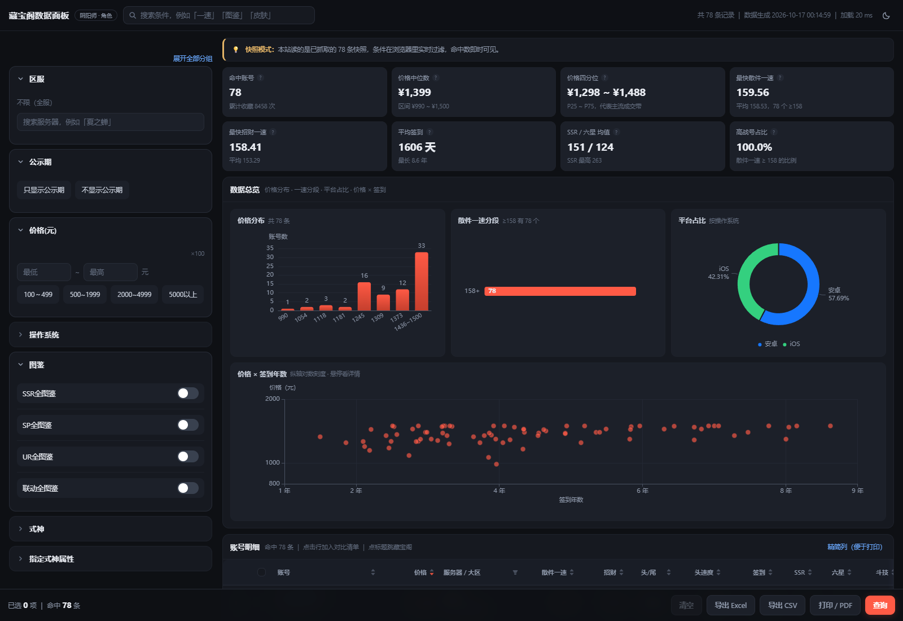
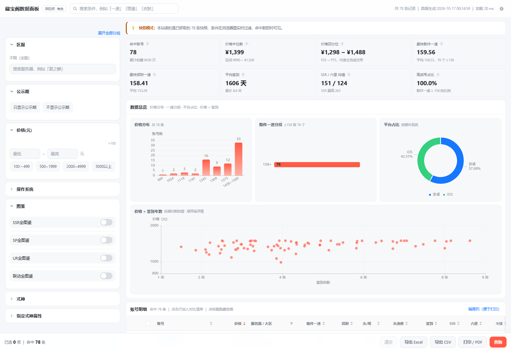

# 藏宝阁数据面板

藏宝阁账号数据的实时查询面板：左侧是条件面板（13 组 / 73 项，与原筛选助手同一套条件定义），右侧是 KPI、图表和明细表，支持深色 / 浅色切换、Excel / CSV 导出、打印成 PDF。

> **注意**：这个界面有两种打开方式，**都必须在本机跑伴随服务**：
>
> | 方式 | 地址 | 说明 |
> |---|---|---|
> | 公网地址 | https://smaxhero.github.io/CBGCHECK/ | 首次打开会问「是否允许访问本地网络」，点**允许**即可用 |
> | 本机地址 | http://127.0.0.1:5173 | 改代码时用，需 `npm run dev` |
>
> 拒绝那个授权、或者本机没跑服务时，页面会显示「未探测到本地查询服务」的引导页。

数据来自**本机伴随服务 + 你自己已登录的浏览器**，每次点「查询」都会重新向藏宝阁拉取：

```
网页（本机打开）  ──HTTP──▶  127.0.0.1:8791 伴随服务  ──CDP──▶  已登录的 Edge  ──▶  藏宝阁
```




---

## 一、它能做什么 / 不能做什么

| 能做 | 不能做 |
|---|---|
| 按 73 项条件实时查询藏宝阁，命中数即时刷新 | 让**公网**那版也实时查询（原因见下） |
| 价格分布、一速分段、平台占比、价格×签到 四类图表 | 绕过登录或权限校验 |
| 表格排序（价格/一速/签到/收藏…）、分页、列筛选 | 抓取用户隐私信息 |
| 勾选多个账号做横向对比 | |
| 导出 Excel / CSV（含 UTF-8 BOM，Excel 不乱码）、打印 A4 横向 PDF | |

### 为什么必须有这个伴随服务

藏宝阁的搜索接口要求登录态，而**浏览器 Cookie 按域名隔离**：任何部署在别处的网页都拿不到 `cbg.163.com` 的会话。这跟实现方式无关，是浏览器的安全规则。所以「带会话的请求」只能由本机一个受你控制的真实浏览器发出——这就是伴随服务的作用。

它不绕过任何校验：请求由页面自己发，带着你自己的登录凭据，和你在藏宝阁网站上手动搜索没有区别。

### 条件透明性

面板上有些条件（图鉴、皮肤、勾玉这类）只有商品详情页才有。这些条件**不会被静默忽略**：服务端会把无法映射到列表接口的参数收集起来，界面明确显示「N 项条件未生效」，命中数永远可信。

---

## 二、快速开始

> 第一次用？看 **[../docs/getting-started.md](../docs/getting-started.md)**（从装 Node.js 到能查数据的分步手册）。
> 最省事的方式是双击仓库根目录的 **`start.bat`**。

前置：Node.js ≥ 20。

**第一步：启动伴随服务**（会弹出一个浏览器窗口）

```bash
node tools/cbg/scraper-service/server.mjs
```

在那个窗口里**登录一次藏宝阁**（登录态存在 `tools/cbg/scraper-service/profile/`，长期有效）。
如需换端口：`--port 8791 --cdp-port 9334`；无头模式 `--headless` 但那就没法手动登录了。

**第二步：启动网页**

```bash
cd cbg-web
npm install
npm run dev          # http://127.0.0.1:5173
```

打开网页后会自动探测服务并查询一次。服务没起来时，页面会显示启动指引（**不会**显示任何旧数据）。

生产构建与本地预览：

```bash
npm run build
npm run preview      # http://127.0.0.1:4173
```

构建产物约 1.2 MB（gzip 后约 450 KB）。antd、echarts、xlsx 各占一个大 chunk，
已通过 `manualChunks` 拆开，浏览器可并行加载并长期缓存。改了功能之后建议跑一遍
[第十节的自测清单](#十上线前的自测清单)。

### 可用的脚本

| 命令 | 作用 |
|---|---|
| `npm run dev` | 开发服务器（HMR） |
| `npm run build` | 类型检查 + 生产构建，产物在 `dist/` |
| `npm run preview` | 预览构建产物（上线前必看这一步） |
| `npm run typecheck` | 只跑类型检查 |
| `npm run seed` | 从原始爬取结果生成数据快照 |
| `npm run fetch` | 数据管道（dry-run，不联网） |
| `npm run preview:style` | 重新生成纯静态样式示例（`public/design/style-preview.html`） |

---

## 三、数据从哪来

### 主路径：实时（网页自己不发请求）

网页不直接访问藏宝阁，而是调用本机伴随服务：

```
网页 ──POST /api/search──▶ 伴随服务 ──CDP 在页面里执行 fetch──▶ 藏宝阁
     ◀──GET /api/result───（异步任务 + 进度轮询）
```

服务端要点：

| 项 | 说明 |
|---|---|
| 接口 | `/api/health` 状态探测、`/api/search` 发起查询、`/api/result` 进度与结果、`/api/logs`、`/api/shutdown` |
| 节流 | 页间固定 **4 秒**，单次最多 **8 页（120 条）**——实测参数见下 |
| 登录态 | 存在 `tools/cbg/scraper-service/profile/`（独立的浏览器用户目录，不碰你日常浏览器的数据） |
| 失败分类 | `e12`→需登录；`CAPTCHA_AUTH` / `MOBILE_AUTH`→需滑块验证；非 JSON→按验证处理。前端据此给出**不同**的指引 |

#### 风控阈值是实测出来的，别调激进

| 参数组合 | 结果 |
|---|---|
| 1.6 秒/页，跑到第 8 页 | 触发 `CAPTCHA_AUTH`（≈120 条被拦） |
| 3.4 秒/页，跑到第 19 页 | 触发 `MOBILE_AUTH`（≈270 条被拦） |
| 连续多轮查询（累计数百条） | 冷却期，第 1 页就返回 `MOBILE_AUTH` |

结论：**短时间内累计请求约 250 条就会触发验证，且验证有冷却期（数分钟）**。
所以默认值取 4 秒/页 + 8 页上限，单次查询约 28 秒。要抓更多请用
`--max-pages` / `--delay` 自行调整，但被拦了只能等冷却并在浏览器里手动过验证。

> 验证拦下来时，服务返回的状态是 `need-captcha`（不是 `need-login`）：
> 登录页解决不了滑块，指引必须分开，否则用户会在登录页上白折腾。

### 附带路径：把结果落成文件（可选，用于归档或分析）

```bash
# 用现有原始数据跑通管道（不联网）
python tools/cbg/fetch_cbg.py --dry-run

# 把服务查到的结果并入一份快照文件
python tools/cbg/fetch_cbg.py --from-file out/query_result.json
```

`tools/cbg/seed_web_data.py` 负责解析：藏宝阁接口返回的是文本描述，前端不能直接排序，所以要把它解析成数值字段。例如

```
desc_sumup_short: "SSR 145   六星式神 176   签到2920天"
highlights:       ["散件一速159.02", "4头1尾", "头速度16.93", "斗技2400", "地域·天下一"]
```

会变成 `ssr` / `six_star` / `sign_days` / `sanjian_speed` / `tou_num` / `wei_num` / `tou_speed` / `pvp` 这些可比较的字段。**同一套解析也用于实时结果**（服务端 `mapRow` 与之口径一致），所以换游戏或换站点时只需要改这一处。

### 公网那版能直接用（需要点一次「允许」）

GitHub Pages 上的页面**可以**连到你本机的伴随服务，但要走一次浏览器授权。

Chrome 142+ / 新版 Edge 引入了「**本地网络访问**」（Local Network Access）权限：
公网来源的页面访问 `127.0.0.1` 这类环回地址时，浏览器会弹提示问用户是否允许。

| 用户的选择 | 结果 |
|---|---|
| **允许** | 面板连上本机服务，实时查询全部可用 |
| 拒绝 / 忽略 | 页面报告下面这个错误，并显示引导页 |

```
Access to fetch at 'http://127.0.0.1:8791/api/health' from origin 'https://<user>.github.io'
has been blocked by CORS policy: Permission was denied for this request
to access the `loopback` address space.
```

关键点：这句话是**权限被拒绝**的结果，不是「硬性禁止」。第一次打开如果直接看到它，
说明提示被忽略或点了拒绝——在地址栏左侧的站点设置里改回「允许」即可。

> 注意这个权限是**按站点**授予的：对某个页面点了允许，那个页面就获得了调用本机服务的能力。
> 所以只对信任的页面授权；不用时把伴随服务关掉最稳妥。

所以两种打开方式都能用：

- **本机打开**（`http://127.0.0.1:5173`）→ 不需要授权，直接探测到服务
- **公网打开**（`https://<user>.github.io/<repo>/`）→ 首次点「允许」后同样可用

两者都要求**本机正在运行伴随服务**。区别只是界面从哪加载。

---

## 四、部署到 GitHub Pages

### 1. 推到仓库

在**仓库根目录**（包含 `.github/` 的那一层）执行：

```bash
git init
git add .
git commit -m "feat: 藏宝阁数据面板"
git branch -M main
git remote add origin https://github.com/<你的用户名>/<仓库名>.git
git push -u origin main
```

> 工作区里还有别的分析脚本和图片，想只发布网页可以把 `cbg-web/`、`tools/`、`.github/` 单独拉一个仓库——
> 那时把 `.github/workflows/deploy.yml` 里的 `working-directory: cbg-web` 相应调整即可。

### 2. 打开 Pages

仓库 **Settings → Pages → Source 选 `GitHub Actions`**（不要选 “Deploy from a branch”）。

### 3. 等部署完成

Actions 里 `Deploy to GitHub Pages` 跑完后，访问：

```
https://<你的用户名>.github.io/<仓库名>/
```

### 工作流做了什么

`.github/workflows/deploy.yml` 每次 push 到 `main` 时：

1. `npm ci` 安装依赖 → `npm run build`（含类型检查）
2. **检查三个数据文件是否就位**，缺了就报错退出（避免部署出一个空面板）
3. 补一个 `dist/.nojekyll`，防止 Pages 的 Jekyll 处理忽略带下划线的文件
4. 上传产物 → 走官方 Pages 部署

### 两个容易踩的点

| 现象 | 原因 / 处理 |
|---|---|
| 页面空白、控制台报 404 | 数据文件没提交。执行 `npm run seed` 后把 `public/data/*.json` 一起 commit |
| 刷新子页面 404 | 本项目用 HashRouter，正常不会有；若你改成了 BrowserRouter，需在 Pages 侧做重定向兜底 |
| 私有仓库开不了 Pages | GitHub 限制：私有仓库的 Pages 需要付费计划，公开仓库免费 |

`vite.config.mjs` 里用的是 `base: './'`，所以仓库根页和 `/<仓库名>/` 子路径页都能直接跑，不需要改配置。

---

## 五、默认筛选条件

打开页面时会自动套用三条默认条件（在 `src/config/defaults.ts` 里改）：

| 条件 | 值 | 提交给接口的参数 | 是否生效 |
|---|---|---|---|
| 价格(元) | 500 ~ 1500 | `price_min=50000` `price_max=150000` | ✅ |
| 资产 · 勾玉 | ≥ 100000 | `goyu=100000` | ❌ 见下 |
| 个人斗技 · 散件一速 | ≥ 158 | `max_sanjian_speed=15800` | ✅ |

核对脚本（会打印字段定位、倍率换算、快照对照）：

```bash
python tools/cbg/check_defaults.py
```

### 为什么「勾玉」这条不会生效

**藏宝阁的列表接口根本不返回勾玉**。实测原始数据里 `other_info` 只有
`top_heros / basic_attrs / top_skins / desc_sumup` 这些摘要字段，78 条里 `goyu` 有值的是 **0 条**——
它属于商品详情数据，要一条条打开详情页才拿得到。

所以这条条件会出现在面板上、也会出现在提交参数里，但**界面会明示「有 N 项条件未生效」**，
不会假装筛过了。代码侧已经把 `goyu` 的解析与过滤都接好（`types.ts` / `predicate.ts` /
`seed_web_data.py`），将来换成详情数据源就自动生效，不用改代码。

### 条件的持久化与恢复

- 你对条件的**改动会被记住**（`localStorage` 键 `cbg-default-conditions`），下次打开用你的选择
- 想回到内置默认：点底栏「**默认条件**」
- 底栏「清空」只清当前条件，**不会**抹掉默认值——下次打开仍从默认条件开始

### 首次查询的时序

默认条件套用完成后才会自动发起第一次查询（`defaultsApplied` 作为前置条件），
否则首次查询会漏掉这几条默认条件。条件后续的改动**不会**自动重查，需要点「查询」。

---

右上角的按钮切换，选择会存进 `localStorage`（键名 `cbg-theme`）。

实现方式和常见做法不太一样，值得说明：

- **CSS 变量 + `data-theme`**：所有自定义组件（筛选面板、表格、图表容器）只使用 `var(--xxx)`，颜色值全部集中在 `src/index.css` 顶部的两组令牌里；切换主题只是把 `<html data-theme>` 从 `dark` 换成 `light`。
- **antd 跟着走**：`ConfigProvider` 按当前主题在 `darkAlgorithm` / `defaultAlgorithm` 之间切换。
- **ECharts 单独处理**：Canvas 读不到 CSS 变量，所以图表配色放在 `src/components/charts/theme.ts` 的 `useChartTheme()` 里，按主题返回整套 token，图表用 `useMemo` 依赖它，切换时重绘。
- **首帧不闪**：`index.html` 里有一段内联脚本，在 React 挂载前就把 `data-theme` 定下来；没存过选择时跟随系统 `prefers-color-scheme`。

> 加新组件时的约定：**不要写死颜色**，用 `var(--surface)` 这类变量。写死了切主题就会「切一半」。
> 判据很简单：改完之后切一次主题，如果还有某块颜色没变，那就是漏了变量。

---

## 六、主题（深色 / 浅色）

右上角按钮切换，选择存进 `localStorage`（键名 `cbg-theme`）。

实现方式和常见做法不太一样，值得说明：

- **CSS 变量 + `data-theme`**：所有自定义组件（筛选面板、表格、图表容器）只使用 `var(--xxx)`，颜色值全部集中在 `src/index.css` 顶部的两组令牌里；切换主题只是把 `<html data-theme>` 从 `dark` 换成 `light`。
- **antd 跟着走**：`ConfigProvider` 按当前主题在 `darkAlgorithm` / `defaultAlgorithm` 之间切换。
- **ECharts 单独处理**：Canvas 读不到 CSS 变量，所以图表配色放在 `src/components/charts/theme.ts` 的 `useChartTheme()` 里，按主题返回整套 token，图表用 `useMemo` 依赖它，切换时重绘。
- **首帧不闪**：`index.html` 里有一段内联脚本，在 React 挂载前就把 `data-theme` 定下来；没存过选择时跟随系统 `prefers-color-scheme`。

> 加新组件时的约定：**不要写死颜色**，用 `var(--surface)` 这类变量。写死了切主题就会「切一半」。
> 判据很简单：改完之后切一次主题，如果还有某块颜色没变，那就是漏了变量。

---

## 七、目录结构

```
cbg-web/
├── public/
│   ├── data/
│   │   ├── listings.json      数据快照（seed 生成）
│   │   ├── filters.json       73 项条件定义
│   │   └── servers.json       127 个区服
│   └── design/
│       ├── style-preview.html 纯静态样式示例（双击即可打开）
│       ├── theme-dark.png     深色主题截图
│       └── theme-light.png    浅色主题截图
├── src/
│   ├── api/                   数据访问层（全站只有这里知道数据从哪来）
│   │   ├── live.ts            伴随服务客户端（健康探测 / 查询 / 结果轮询）
│   │   └── searchSchema.ts    schema 类型定义
│   ├── components/
│   │   ├── condition/         条件控件（按 field.type 分发）
│   │   ├── charts/            ECharts 封装与四张图
│   │   ├── FilterPanel.tsx    条件面板（13 组 / 73 项）
│   │   ├── DataTable.tsx      明细表（排序/分页/列筛选/行勾选）
│   │   ├── DashboardLayout.tsx 骨架（吸顶头 + chips + 底栏查询控制台）
│   │   ├── CompareDrawer.tsx  对比清单
│   │   ├── ErrorBoundary.tsx  顶层错误边界（渲染异常画在页面上，避免白屏）
│   │   └── PrintView.tsx      打印视图
│   ├── hooks/                 实时数据源、条件 schema、主题、渲染审计
│   ├── utils/                 参数转换、过滤谓词、统计、导出、格式化
│   └── index.css              设计令牌 + 全部组件样式
└── vite.config.mjs
```

---

## 八、Windows 上的两个构建坑

如果你在 Windows 的受限环境（沙箱、受限 ACL）里跑，可能会遇到：

1. **`npm install` 报 `EPERM ... npm-cache`**
   npm 默认缓存目录可能不可写，把缓存指到项目内：
   ```powershell
   npm install --cache ..\.npmcache
   ```

2. **`vite build` 报 `spawn EPERM` 或临时目录 `Access is denied`**
   Vite 在 Windows 上需要 `spawn` 子进程做安全路径解析，esbuild 也需要；受限环境会拒绝。
   把临时目录指到工作区内通常就能过：
   ```powershell
   $env:TMP = "$PWD\..\.tmp"; $env:TEMP = "$PWD\..\.tmp"
   npm run build
   ```
   正常开发机不需要这些。

---

## 九、开发时踩过的坑（改代码前请先看这一节）

以下问题是实测出来的，都已修复。**它们有个共同特征：不会报错，只会安静地给出错误结果**，所以特别值得记下来。

### 0. Effect 依赖不稳定导致的无限更新循环（最凶险，整页白屏）

把「条件面板的已选状态」同步到 store 的 effect，如果依赖数组里含有一个**每次渲染都新建的对象**
（例如未 memo 的 `{ params, labels }`），就会形成自激回路：

```
effect 触发 → 写 store → 组件重渲染 → 依赖又是新对象 → effect 再触发 → …
```

React 判定循环后**会把整棵树卸载**，页面变成空白，控制台只留一句
`Maximum update depth exceeded`，且组件栈指向的位置往往不是真正的源头。
本项目实测时就卡在这里很久，错误栈先后指向过 antd 的 `Portal`、`Drawer`，其实都只是被牵连。

**修法**：不要依赖「上游引用稳定」这种脆弱假设，改成**按内容比较**：

```ts
// src/pages/Dashboard.tsx
const paramsFingerprint = useMemo(
  () => Object.keys(built.params).filter(k => k !== 'search_type').sort()
          .map(k => `${k}=${built.params[k]}`).join('&'),
  [built.params],
);
const lastFingerprint = useRef<string | null>(null);
useEffect(() => {
  if (lastFingerprint.current === paramsFingerprint) return;  // 内容没变就不写 store
  lastFingerprint.current = paramsFingerprint;
  setParams(built.params, built.labels);
}, [built, paramsFingerprint, setParams]);
```

同理，**「首次自动查询」这类 effect 不要依赖参数对象**——用 `useRef` 取一次性快照。

> 排障工具：`src/hooks/useRenderCount.ts`（渲染次数写进 `localStorage.__render_audit`，
> 页面被卸载后仍可读）、`src/components/ErrorBoundary.tsx`（异常连同组件栈画在页面上）。
> 这两个就是定位上述问题时装上的，建议保留。

### 1. 速度类条件恒为 0 条 —— 参数倍率与快照单位不一致（最隐蔽）

面板上的速度条件在 schema 里标了 `valueMultiply: 100`：

```
界面填 159  ──×100──▶  接口参数 max_sanjian_speed=15900   （藏宝阁接口收整数，必须 ×100）
快照里存的                    sanjian_speed = 159.56      （原始小数）
```

直接拿 `15900 >= 159.56` 去比，**永远不成立**，于是所有一速/头速度/尾速度条件都返回 0 条，
而图表（用原始值画）看起来完全正常——很容易误判成「这批数据就是没有 159 以上的号」。

处理方式在 `src/utils/predicate.ts`：

```ts
/** 面板输入会 ×100 转成接口参数，快照里是原始小数，比较前必须除回来 */
const SCALE_100 = (raw: string) => Number(raw) / 100;

max_sanjian_speed: (row, raw) => gte(row, 'sanjian_speed', raw, true),
//                                                            ^^^^ scale=true
```

> **改动提示**：`filters.json` 里凡是带 `valueMultiply` 的字段，谓词里都要做对应换算。
> 目前整数类字段（头个数、签到天数、SSR、斗技分…）倍率是 1，不需要处理。
> 换游戏或站点后，**务必先在快照里确认单位**，再写比较逻辑。

### 2. 饼图中心的数字不显示 —— ECharts 按需引入漏了组件

按需引入（`echarts/core` + `echarts.use([...])`）能大幅减小体积，但**漏注册的组件不会报编译错误，
只会在运行时打印一行警告并静默不渲染**：

```
[ECharts] Component graphic is used but not imported.
import { GraphicComponent } from 'echarts/components';
echarts.use([GraphicComponent]);
```

`PlatformPieChart` 用 `graphic` 画环形中心的「总数 / 账号」，所以必须在 `src/components/charts/EChart.tsx`
里注册 `GraphicComponent`。加新图表类型时同样要检查：用了什么组件就注册什么（`DataZoom`、`MarkLine`、
`VisualMap`、`RadarChart`… 都是同一类坑）。

### 3. 窄屏图表被裁掉右边 —— resize 时机早于 CSS 回流

窗口缩放时，`resize` 事件触发的那一刻 CSS 栅格可能还没完成回流，此时读到的容器宽度仍是旧值，
`chart.resize()` 就把画布定在了错误尺寸上。表现是：**窄屏下图表只显示左边一部分，拉回桌面后宽度还会错乱**。

只监听 `window.resize` 或只用 `ResizeObserver` 都不够。`EChart.tsx` 里的做法是逐帧核对：

```ts
const sync = (attempt = 0) => {
  if (chart.getWidth() !== el.clientWidth || chart.getHeight() !== el.clientHeight) chart.resize();
  // 还没追上就等下一帧，最多约 30 帧
  if (attempt < 30 && /* 仍不一致 */) raf = requestAnimationFrame(() => sync(attempt + 1));
};
```

### 4. 商品链接打开是错的 —— 两个 ID 长得一模一样（最易复发）

藏宝阁列表接口返回**两个形状几乎相同的 ID**：

```
game_ordersn: 202610160301613-12-SDI0LBZYNXWYY     ← 详情页 URL 用这个
eid         : 202610130201616-12-MXNCUO8JJZRGG     ← 不是这个
```

两者都是「时间戳-区服-随机串」，肉眼几乎分不出，**78 行里没有一行两者相同**。
用错会跳到不存在的商品页，而且**不报错**——页面正常打开，只是内容不对，所以特别难发现。

正确形式（从站点抓下来的列表页里抽出的真实链接）：

```
https://yys.cbg.163.com/cgi/mweb/equip/12/202610160301613-12-SDI0LBZYNXWYY
                                          └ serverid ┘└──── game_ordersn ────┘
```

约定：**行数据的 `id` 统一等于 `game_ordersn`**，`cbgDetailUrl()` 直接拿它拼。
新增数据源时务必确认放进 `id` 的是订单号。

核对脚本（打印字段定位、真实链接对照、全量一致性）：

```bash
python tools/cbg/verify_links.py
```

### 附带：Vite 文件监听会被原子写盘搞崩

有些编辑器/工具用「临时目录 + 原子替换」保存文件，会在源码目录里短暂生成 `.xxx.tmpdir/`。
chokidar 去 watch 这些转瞬即逝的路径会抛 `EBUSY` 并**直接结束 dev 进程**：

```
Error: EBUSY: resource busy or locked, watch '...\.EChart.tsx.243040....tmpdir\EChart.tsx.tmp'
```

已在 `vite.config.mjs` 的 `server.watch.ignored` 里忽略 `**/.*.tmpdir/**`、`**/*.tmp`。

### 附带：dev 服务器的模块缓存会和磁盘不一致

如果在 dev 运行期间杀过 node 进程，Vite 的内存模块图可能残留旧版本。表现极具迷惑性：
磁盘源码明明有某段代码，编译产物却是旧的——例如 react 的导入里少了 `useRef`，
于是浏览器报 `ReferenceError: useRef is not defined`，而你怎么看源码都是对的。

处理：停掉 dev，删 `node_modules/.vite`，重启。另外 `vite.config.mjs` 的
`server.watch.ignored` 已尽量降低这类冲突的概率。

### 附带：antd v5 + React 19 需要补丁包

npm 会把 `react` 解析到 19.x，而 antd v5 官方只支持到 18，控制台会警告：

```
Warning: [antd: compatible] antd v5 support React is 16 ~ 18.
```

已按官方方案装了 `@ant-design/v5-patch-for-react-19`，并在 `src/main.tsx` 里
**放在 antd 之前**导入（顺序不能变，它要替换 ReactDOM 的 render/unmount）。
不引它的话，`message` / `notification` / `Modal` 这些静态方法在 React 19 下会静默失效。

> 另注：静态方法还拿不到 `ConfigProvider` 的主题上下文（深色下弹窗会是浅色）。
> 需要弹窗时用 `App.useApp()` 取实例，而不是直接 `import { message } from 'antd'`。

---

## 十、上线前的自测清单

改动之后，建议按这个顺序过一遍（这次全量测试就是按它走的）：

| # | 检查项 | 期望 |
|---|---|---|
| 1 | 浏览器控制台 | 无错误、无 ECharts 组件警告 |
| 2 | 拖窗口从宽到窄再拉回 | 图表跟着缩放，不被裁切，宽高与容器一致 |
| 3 | 每个速度条件各填一个阈值 | 命中数**不为 0**（若为 0，先查第 1 条坑） |
| 4 | 一个快照里没有数据的条件（如图鉴开关） | 提示「有 N 项暂未参与过滤」，而不是静默忽略 |
| 5 | 导出 CSV 用 Excel 打开 | 中文不乱码（依赖 UTF-8 BOM） |
| 6 | 打印预览 | A4 横向、表头每页重复、主界面隐藏 |
| 7 | 切换主题 | body 底色、表格、图表坐标轴同时变化 |
| 8 | 刷新页面 | 对比清单与主题保留，条件清空 |
| 9 | `npm run build` | 类型检查与构建均通过 |

---

## 十一、数据与合规

- 抓取的是**藏宝阁公开列表页的聚合信息**（价格、区服、一速、签到天数这类账号属性）；
- 请求由**你自己已登录的浏览器**发出，工具不读取、不保存账号密码，登录态只存在本地 `cbg-filter-kit/.browser-profile/`；
- 抓取要控制频率（间隔 ≥1.6 秒），不要高频批量；
- 仅供个人比价参考，**不要用于商业用途或二次分发数据**。请遵守藏宝阁用户协议，因使用不当导致的账号风险由使用者自行承担。
